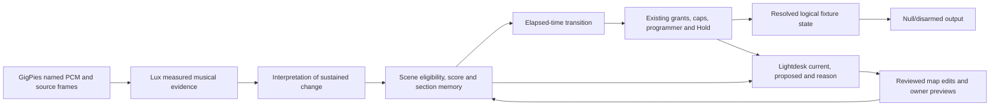

# Musical scenes across GigPies, Lux and Lightdesk

GigPies supplies named PCM analysis windows and source timing. SHR Lux owns the
musical estimates, scene map, director, elapsed-time fades and lighting authority.
SHR Lightdesk reads that owner state, edits the map and requests owner previews.
A preview never establishes physical fixture output. The integrated path remains
null/disarmed; real fixture personalities, DMX and physical qualification are absent.

The owning [Lux scene-map reference](../../../shr-lux/docs/notes/0035-scene-map.md)
defines the versioned map, defaults, selection policy, recovery and wire contract.
The [Lightdesk authoring guide](../../../shr-lightdesk/docs/SCENE_MAP.md) defines
console controls. The [integration card](../archive/records/2026-10-11-gp-scenes.md)
records completed software acceptance and remaining qualification limits.



Mood is authored independently of lift. RGB choices express the authored palette;
role intensity and lift determine the requested brightness. A dark palette can
have strong lift, and a bright palette can remain intimate. Major/minor does not
select an emotion, energy does not establish chorus, and a chord change alone
does not warrant a scene switch. Harmonic relationships can inform a transition,
never an arbitrary key-to-colour lookup.

The starting map contains Intimate, Floating, Driving, Building, Open/Lift and
Release. These are lighting intentions, not recognized song-form facts. Lux's
recurring section IDs describe locally recurring acoustic arrangements. Their
identity is separate from tentative verse/chorus labels, whose confidence does
not measure the reliability of the ID itself. Scene memory is local to a valid
source context and is cleared after source loss/recalibration/restart.

The director's selected scene, its interpolated intended values, and actual
resolved values are distinct. A human Hold may retain a previous look while the
director proposes another. Neither a map edit nor an owner preview grants AUTO
permission. Explicit fixture scope, intensity/RGB caps, bounded grants and fresh
calibrated analysis remain necessary. Source loss is not treated as musical
silence. Startup/recovery does not restore grants or resume a transition.

## Reproducible software episode

Build each owning executable with Rust 1.97.1, its committed lockfile, normal
`target/`, `CARGO_INCREMENTAL=0`, one job and the shared
`/home/shome/p/.gigpies-build.lock` reservation. The source example requires no
hardware feature. Lightdesk's regular offscreen renderer requires no physical
display. Use explicit executable identities:

```sh
python3 scripts/check_scene_director.py \
  --source /home/shome/p/gigpies/target/debug/examples/music-analysis-source \
  --lux /home/shome/p/shr-lux/target/release/lux-service \
  --lightdesk /home/shome/p/shr-lightdesk/target/release/shr-lightdesk \
  --lux-check-helper /home/shome/p/shr-lux/scripts/check-lux-service.py \
  --role-provider /home/shome/p/gigpies/target/release/gigpies-role-lease \
  --evidence /home/shome/p/gigpies/artifacts/gp-scenes/integration.json \
  --preview /home/shome/p/gigpies/artifacts/gp-scenes/preview
```

This explicit roughly 100-second integration check starts only owned children
and private Unix endpoints. Authoring uses the actual GP09 role broker with
explicit synthetic display/controller descriptors; it does not discover devices. Its PCM sequence contains a quiet arrangement, a
sustained build, drive, the quiet arrangement returning, another contrast and
returning drive. C/F/G chords change inside those passages. No scene, mood or
section label enters the analysis transport. The harness checks actual owner
choices and resolved logical RGB/intensity, recurrence, malformed-map refusal,
Hold, source loss and disarmed recovery, then reaps its children. Explicit repeat
grants belong to this finite synthetic harness; the product never renews an
AUTO grant automatically.

## Limits

Beat and downbeat remain unavailable: fades use elapsed time and claim no beat,
bar or phrase alignment. Analysis confidence is heuristic, not a calibrated
probability. Synthetic triads, source balance and levels do not establish live
band, genre or rehearsal accuracy. Recognition with bleed, distortion, changing
arrangements and imperfect source bindings needs separate evaluation. Physical
fixture rendering, actual displays/controllers, sustained Pi resource behavior
and complete-show acceptance require separately authorized qualification.
